# RutaSV – Funcionalidades y Diseño de Base de Datos

> Marketplace de experiencias turísticas locales de El Salvador.
> Motor: **PostgreSQL 18** · Convención: tablas y columnas en `snake_case`, claves primarias `uuid`, fechas en `timestamptz` (UTC).

## Índice
1. [[#1. Actores y permisos]]
2. [[#2. Funcionalidades por actor]]
3. [[#3. Reglas de negocio]]
4. [[#4. Catálogos / enumeraciones]]
5. [[#5. Diccionario de datos]]
6. [[#6. Relaciones (resumen)]]
7. [[#7. Índices y restricciones clave]]
8. [[#8. Diagrama entidad-relación (Mermaid)]]
9. [[#9. Notas de implementación]]

---

## 1. Actores y permisos

| Actor | ¿Tiene cuenta? | Rol en BD (`app_user.role`) | Alcance |
|---|---|---|---|
| Administrador | Sí | `ADMIN` | Control total del sistema |
| Operador | Sí | `OPERADOR` | Gestiona sus empresas, experiencias, disponibilidad y reservas recibidas. No existe registro directo: es un `VISITANTE` cuya solicitud (con documentos) aprobó el admin |
| Visitante con cuenta (turista) | Sí | `VISITANTE` | Explora, reserva, cancela, reseña y ve su historial |
| Visitante sin cuenta | No | — (no se guarda en BD) | Solo lectura del catálogo público |

Matriz resumida:

| Acción                                                        | Sin cuenta | Visitante |              Operador              |    Admin     |
| ------------------------------------------------------------- | :--------: | :-------: | :--------------------------------: | :----------: |
| Ver y filtrar catálogo                                        |     Sí     |    Sí     |                 Sí                 |      Sí      |
| Ver detalle (fotos, mapa, reseñas, horarios)                  |     Sí     |    Sí     |                 Sí                 |      Sí      |
| Registrarse / iniciar sesión                                  |     Sí     |     —     |                 —                  |      —       |
| Solicitar ser operador (empresa + documentos)                 |     No     |    Sí     |                 —                  |      —       |
| Reservar, cancelar, ver "mis reservas"                        |     No     |    Sí     | Sí (cuando le reservan en persona) | Sí (gestión) |
| Reseñar tras reserva completada                               |     No     |    Sí     |                 No                 |   moderar    |
| Favoritos                                                     |     No     |    Sí     |                 No                 |      No      |
| Crear/editar empresa y experiencias propias                   |     No     |    No     |                 Sí                 |  Sí (todas)  |
| Gestionar disponibilidad y reservas de sus experiencias       |     No     |    No     |                 Sí                 |      Sí      |
| Responder reseñas propias                                     |     No     |    No     |                 Sí                 |      Sí      |
| Aprobar solicitudes de operador, empresas/experiencias, gestionar usuarios y catálogos |     No     |    No     |                 No                 |      Sí      |

---

## 2. Funcionalidades por actor

### 2.1 Visitante sin cuenta (público)
| ID | Funcionalidad | Detalle |
|---|---|---|
| RF-P01 | Listar catálogo | Solo experiencias con `status = PUBLICADA` y empresa `APROBADA`. Paginado, con foto de portada, título, categoría, municipio, precio y calificación promedio. |
| RF-P02 | Búsqueda por texto | Full-text search de PostgreSQL sobre título, descripción corta y descripción. |
| RF-P03 | Filtros combinables | Categoría (Comida, Playa, Montaña, Surf, Caminata…), departamento, municipio, rango de precio, calificación mínima, fecha deseada (solo con cupos disponibles), día/horario de atención, duración, dificultad. |
| RF-P04 | Ordenamiento | Relevancia, precio (asc/desc), mejor calificadas, más recientes. |
| RF-P05 | Ver ficha de detalle | Galería de imágenes, descripción, qué incluye/no incluye, qué llevar, precio, duración, horarios de atención, ubicación exacta en mapa (Leaflet con `latitude`/`longitude`), datos de la empresa, reseñas con estrellas y promedio. |
| RF-P06 | Ver disponibilidad pública | Calendario de fechas/horarios con cupos restantes (sin permitir reservar). |
| RF-P07 | Invitación a registro | Al intentar reservar o ver reservas, redirigir a registro/inicio de sesión. |
| RF-P08 | Registro de cuenta | Formulario (nombre, apellido, correo, contraseña, teléfono) → rol `VISITANTE`; envía correo de verificación. |

### 2.2 Visitante con cuenta (turista)
Incluye todo lo anterior, más:

| ID | Funcionalidad | Detalle |
|---|---|---|
| RF-V01 | Iniciar / cerrar sesión | JWT + refresh token. Recuperación de contraseña por correo (`user_token`). |
| RF-V02 | Gestionar perfil | Editar datos personales, foto, cambiar contraseña. |
| RF-V03 | Crear reserva | Elige experiencia → fecha/horario con cupo → número de personas → datos de contacto y notas. El sistema valida cupos, estado de la disponibilidad, límites por reserva y fecha futura. Crea la reserva con precio congelado (`unit_price`) y descuenta cupos en una transacción. |
| RF-V04 | Pago simulado (demo) | Marca `payment_status = PAGADO_DEMO`. Desacoplado para integrar una pasarela real a futuro. |
| RF-V05 | Correo de reserva | Al crear/confirmar la reserva se envía correo con código, experiencia, fecha, hora, personas, total y estado. Se registra en `email_notification`. |
| RF-V06 | Mis reservas | Listado con filtros por estado y fechas; detalle de cada reserva y su línea de tiempo (`reservation_history`). |
| RF-V07 | Cancelar reserva | Solo si cumple la política de cancelación (`cancellation_policy_hours` antes del inicio). Libera cupos, registra motivo y envía correo. |
| RF-V08 | Reseñar | Solo si la reserva está `COMPLETADA` y no existe reseña previa. Calificación 1–5 estrellas + comentario opcional. Actualiza promedio de la experiencia. |
| RF-V09 | Editar/eliminar su reseña | Dentro de una ventana de tiempo configurable. |
| RF-V10 | Favoritos | Guardar/quitar experiencias y ver su lista. |
| RF-V11 | Solicitar ser operador | Desde su perfil, el visitante llena el formulario de la empresa (la misma de RF-O02) y adjunta documentos (foto del DUI, foto del negocio o servicio, enlace a redes u otro respaldo). Se crea una `operator_request` en estado `PENDIENTE`; hasta que el admin decida no puede publicar nada. Solo puede tener una solicitud activa. |

### 2.3 Operador
| ID     | Funcionalidad                | Detalle                                                                                                                                                                                                                                                            |
| ------ | ---------------------------- | ------------------------------------------------------------------------------------------------------------------------------------------------------------------------------------------------------------------------------------------------------------------ |
| RF-O01 | Alta como operador           | No hay registro directo. Un visitante envía la solicitud de RF-V11; al aprobarla el admin, su rol pasa a `OPERADOR` y su empresa a `APROBADA`. También puede crearlo el admin directamente (RF-A01).                                                              |
| RF-O02 | Gestionar empresas           | Crear/editar empresa: nombre comercial, descripción, contacto, logo, ubicación. Queda `PENDIENTE` hasta que el admin la apruebe. Un operador puede tener varias empresas.                                                                                          |
| RF-O03 | CRUD de experiencias         | Título, descripción, categorías, precio, duración, ubicación (municipio + coordenadas + referencia), qué incluye, requisitos, políticas, cupo máximo por reserva. Estados: `BORRADOR` → `PENDIENTE_REVISION` → `PUBLICADA`/`RECHAZADA`; puede `PAUSAR` o archivar. |
| RF-O04 | Galería de imágenes          | Subir varias fotos (MinIO), definir portada, orden y texto alternativo; se generan miniaturas.                                                                                                                                                                     |
| RF-O05 | Horarios semanales           | Definir horarios de atención/salidas por día de la semana con hora de inicio/fin y cupos por defecto.                                                                                                                                                              |
| RF-O06 | Gestionar disponibilidad     | Generar disponibilidad por rango de fechas a partir de los horarios semanales; bloquear/abrir fechas, editar cupos y tal vez: precio especial por fecha.                                                                                                           |
| RF-O07 | Calendario                   | Vista de calendario con ocupación y reservas por día.                                                                                                                                                                                                              |
| RF-O08 | Gestionar reservas recibidas | Listar y filtrar; confirmar, rechazar, marcar `COMPLETADA` o `NO_ASISTIO`; cancelar con motivo. Cada cambio queda en `reservation_history` y notifica al turista.                                                                                                    |
| RF-O09 | Confirmación automática      | Opción por experiencia: si está activa, la reserva nace `CONFIRMADA`; si no, queda `PENDIENTE` hasta que el operador la confirme.                                                                                                                                  |
| RF-O10 | Responder reseñas            | Una respuesta pública por reseña.                                                                                                                                                                                                                                  |
| RF-O11 | Panel de métricas            | Reservas por estado, ingresos demo, calificación promedio, experiencias más reservadas.                                                                                                                                                                            |
| RF-O12 | Reserva presencial           | El operador registra una reserva de un cliente que se inscribe en persona y no usa la plataforma (sin cuenta). Captura nombre, teléfono y, opcionalmente, correo; la reserva queda con `source = PRESENCIAL`, sin `visitor_id` y con `created_by` = el operador. Solo sobre sus propias experiencias y con las mismas validaciones de cupo.                         |

### 2.4 Administrador
| ID | Funcionalidad | Detalle |
|---|---|---|
| RF-A01 | Gestión de usuarios | Listar, buscar, crear, editar, activar/suspender/bloquear, cambiar rol, forzar restablecimiento de contraseña. |
| RF-A02 | Aprobación de solicitudes de operador y empresas | Cola de `operator_request` filtrable por estado y antigüedad. Revisa los documentos y aprueba o rechaza (con motivo) en un solo paso: al aprobar, la empresa pasa a `APROBADA` y el usuario a `OPERADOR`. También puede suspender empresas. Los documentos solo los ve el admin. |
| RF-A03 | Moderación de experiencias | Revisar y publicar/rechazar experiencias; despublicar contenido inapropiado. |
| RF-A04 | Gestión de catálogos | CRUD de categorías, departamentos y municipios. |
| RF-A05 | Gestión de reservas | Ver todas las reservas, intervenir en cualquier cambio de estado. |
| RF-A06 | Moderación de reseñas | Ocultar/restaurar reseñas reportadas o inapropiadas. |
| RF-A07 | Monitoreo de correos | Ver `email_notification`, reintentar envíos fallidos. |
| RF-A08 | Auditoría | Consultar `audit_log` (quién hizo qué y cuándo). |
| RF-A09 | Dashboard global | Usuarios, empresas, experiencias, reservas por periodo, categorías más populares, calificaciones. |

---

## 3. Reglas de negocio

| ID    | Regla                                                                                                                                                                                                                                                                                                                                        |
| ----- | -------------------------------------------------------------------------------------------------------------------------------------------------------------------------------------------------------------------------------------------------------------------------------------------------------------------------------------------- |
| RN-01 | El correo del usuario es único y no distingue mayúsculas (`citext`).                                                                                                                                                                                                                                                                         |
| RN-02 | Solo se muestran públicamente experiencias `PUBLICADA` cuya empresa esté `APROBADA` y cuyo operador esté `ACTIVO`.                                                                                                                                                                                                                           |
| RN-03 | **No hay sobreventa:** `reserved_capacity <= total_capacity` (CHECK) y la reserva se hace en transacción con bloqueo de fila (`SELECT … FOR UPDATE`) sobre `availability`.                                                                                                                                                                   |
| RN-04 | Una reserva solo puede hacerse sobre una disponibilidad `ABIERTA`, futura, con cupos suficientes y respetando `min_people`/`max_people` de la experiencia.                                                                                                                                                                                   |
| RN-05 | `unit_price` y `total` se congelan al reservar (el cambio posterior de precio no afecta reservas existentes). `total = unit_price × people_count`.                                                                                                                                                                                           |
| RN-06 | Estados de reserva: `PENDIENTE → CONFIRMADA → COMPLETADA`; `PENDIENTE/CONFIRMADA → CANCELADA`; `CONFIRMADA → NO_ASISTIO`; `PENDIENTE → RECHAZADA`. Estados finales no cambian.                                                                                                                                                               |
| RN-07 | Al pasar a `CANCELADA` o `RECHAZADA`, los cupos vuelven a `availability.reserved_capacity`.                                                                                                                                                                                                                                                  |
| RN-08 | El visitante solo cancela antes de `date - cancellation_policy_hours`. Operador/admin pueden cancelar con motivo.                                                                                                                                                                                                                            |
| RN-09 | Una reserva hecha desde la plataforma (`source = WEB`) siempre pertenece a un usuario con cuenta (`visitor_id` obligatorio). La única excepción es la reserva presencial (`source = PRESENCIAL`, RN-19), donde `visitor_id` es nulo. El visitante sin cuenta nunca genera reservas por sí mismo.                                             |
| RN-10 | Solo una reseña por reserva (`UNIQUE(reservation_id)`) y únicamente si la reserva está `COMPLETADA` y tiene `visitor_id` (las reservas presenciales sin cuenta no se reseñan).                                                                                                                                                               |
| RN-11 | `experience.average_rating` y `total_reviews` se recalculan al crear/editar/ocultar reseñas.                                                                                                                                                                                                                                                 |
| RN-12 | Cada cambio de estado de reserva inserta una fila en `reservation_history`.                                                                                                                                                                                                                                                                  |
| RN-13 | Cada experiencia tiene exactamente una imagen de portada (`is_cover = true`).                                                                                                                                                                                                                                                                |
| RN-14 | Las imágenes se guardan en MinIO; en BD solo se guarda la clave/URL.                                                                                                                                                                                                                                                                         |
| RN-15 | Borrado lógico en usuarios, empresas y experiencias (no se eliminan si tienen reservas).                                                                                                                                                                                                                                                     |
| RN-16 | Todo cambio sensible (aprobaciones, bloqueos, cambios de rol, cancelaciones forzadas, reservas presenciales) se registra en `audit_log`.                                                                                                                                                                                                     |
| RN-17 | Nadie se registra directamente como operador. El rol `OPERADOR` solo se asigna al aprobar una `operator_request`, y la aprobación (solicitud + empresa + cambio de rol) se hace en una sola transacción. Un usuario tiene como máximo una solicitud `PENDIENTE`.                                                                             |
| RN-18 | Los documentos de una solicitud se guardan en un bucket **privado** de MinIO; solo el admin puede verlos (URL temporal firmada). Tras decidir la solicitud se conservan durante un plazo limitado y luego se eliminan (`deleted_at`). El número de DUI no se muestra públicamente.                                                           |
| RN-19 | Reserva presencial: solo un `OPERADOR` (o el admin) puede crearla, únicamente sobre experiencias de sus empresas. Pasa por las mismas reglas de cupo (RN-03, RN-04) y el mismo bloqueo de fila. Guarda `contact_name` y `contact_phone` (obligatorios) y `contact_email` opcional, `source = PRESENCIAL` y `created_by` = quien la registró. |

---

## 4. Catálogos / enumeraciones

Se implementan como `varchar` con CHECK o como enums de EF Core.

| Enumeración | Valores |
|---|---|
| `rol_usuario` | `ADMIN`, `OPERADOR`, `VISITANTE` |
| `estado_usuario` | `PENDIENTE_VERIFICACION`, `ACTIVO`, `SUSPENDIDO`, `BLOQUEADO`, `ELIMINADO` |
| `estado_empresa` | `PENDIENTE`, `APROBADA`, `RECHAZADA`, `SUSPENDIDA` |
| `estado_experiencia` | `BORRADOR`, `PENDIENTE_REVISION`, `PUBLICADA`, `PAUSADA`, `RECHAZADA`, `ARCHIVADA` |
| `dificultad` | `FACIL`, `MODERADA`, `DIFICIL` |
| `estado_disponibilidad` | `ABIERTA`, `BLOQUEADA`, `CERRADA` (cerrada = cupos llenos o ya pasó) |
| `estado_reserva` | `PENDIENTE`, `CONFIRMADA`, `CANCELADA`, `RECHAZADA`, `COMPLETADA`, `NO_ASISTIO` |
| `origen_reserva` | `WEB`, `PRESENCIAL` |
| `estado_pago` | `PENDIENTE`, `PAGADO_DEMO`, `REEMBOLSADO_DEMO` |
| `estado_solicitud_operador` | `PENDIENTE`, `APROBADA`, `RECHAZADA`, `CANCELADA` (cancelada = la retiró el solicitante) |
| `tipo_documento_solicitud` | `DUI_FRENTE`, `DUI_REVERSO`, `FOTO_NEGOCIO`, `ENLACE_REDES`, `REGISTRO_TURISMO`, `OTRO` |
| `estado_resena` | `VISIBLE`, `OCULTA`, `REPORTADA` |
| `tipo_token` | `VERIFICAR_EMAIL`, `RESET_PASSWORD`, `REFRESH` |
| `tipo_notificacion` | `RESERVA_CREADA`, `RESERVA_CONFIRMADA`, `RESERVA_CANCELADA`, `RESERVA_RECHAZADA`, `RECORDATORIO`, `VERIFICAR_EMAIL`, `RESET_PASSWORD`, `NUEVA_RESERVA_OPERADOR`, `SOLICITUD_OPERADOR_APROBADA`, `SOLICITUD_OPERADOR_RECHAZADA` |
| `estado_envio` | `PENDIENTE`, `ENVIADO`, `FALLIDO` |

---

## 5. Diccionario de datos

> **Leyenda:** PK = clave primaria · FK = clave foránea · UQ = único · NN = no nulo · DEF = valor por defecto.

### 5.1 `department`
Catálogo geográfico de los 14 departamentos de El Salvador.

| Campo | Tipo | Restricciones | Descripción |
|---|---|---|---|
| id | smallint | PK | Identificador |
| name | varchar(60) | NN, UQ | Nombre (ej. La Libertad) |

### 5.2 `municipality`
Catálogo de municipios, asociados a un departamento.

| Campo | Tipo | Restricciones | Descripción |
|---|---|---|---|
| id | int | PK | Identificador |
| department_id | smallint | FK → department.id, NN | Departamento al que pertenece |
| name | varchar(80) | NN | Nombre (ej. El Tunco / Tamanique) |
| | | UQ(department_id, name) | Evita duplicados |

### 5.3 `app_user`
Todas las personas con cuenta: administradores, operadores y turistas.

| Campo | Tipo | Restricciones | Descripción |
|---|---|---|---|
| id | uuid | PK | Identificador |
| email | citext | NN, UQ | Correo (login) |
| password_hash | varchar(255) | NN | Hash (BCrypt/Argon2), nunca texto plano |
| first_name | varchar(80) | NN | Nombres |
| last_name | varchar(80) | NN | Apellidos |
| phone | varchar(20) | | Teléfono de contacto |
| photo_url | varchar(500) | | Foto de perfil (MinIO) |
| preferred_language | varchar(5) | DEF 'es' | `es` / `en` (para correos) |
| role | varchar(15) | NN, DEF 'VISITANTE' | Ver `rol_usuario` |
| status | varchar(25) | NN, DEF 'PENDIENTE_VERIFICACION' | Ver `estado_usuario` |
| email_verified | boolean | NN, DEF false | Si confirmó su correo |
| last_login_at | timestamptz | | Último inicio de sesión |
| created_at | timestamptz | NN, DEF now() | Alta |
| updated_at | timestamptz | NN, DEF now() | Última modificación |
| deleted_at | timestamptz | | Borrado lógico |

### 5.4 `user_token`
Tokens de un solo uso o de larga duración (verificación de correo, recuperación de contraseña, refresh token).

| Campo | Tipo | Restricciones | Descripción |
|---|---|---|---|
| id | uuid | PK | Identificador |
| user_id | uuid | FK → app_user.id, NN | Dueño del token |
| type | varchar(20) | NN | Ver `tipo_token` |
| token_hash | varchar(255) | NN, UQ | Hash del token (no se guarda en claro) |
| expires_at | timestamptz | NN | Vencimiento |
| used_at | timestamptz | | Cuándo se consumió / revocó |
| created_at | timestamptz | NN, DEF now() | Creación |

### 5.5 `company`
Negocio u organización de un operador que ofrece experiencias.

| Campo | Tipo | Restricciones | Descripción |
|---|---|---|---|
| id | uuid | PK | Identificador |
| operator_id | uuid | FK → app_user.id, NN | Usuario con rol `OPERADOR` responsable |
| trade_name | varchar(150) | NN | Nombre visible |
| legal_name | varchar(200) | | Nombre legal (opcional) |
| description | text | | Presentación de la empresa |
| contact_email | varchar(150) | | Correo público |
| contact_phone | varchar(20) | | Teléfono público |
| whatsapp | varchar(20) | | WhatsApp |
| website | varchar(300) | | Sitio web / redes |
| logo_url | varchar(500) | | Logo (MinIO) |
| municipality_id | int | FK → municipality.id | Ubicación de la sede |
| address | varchar(300) | | Dirección escrita |
| status | varchar(15) | NN, DEF 'PENDIENTE' | Ver `estado_empresa` |
| rejection_reason | varchar(500) | | Motivo si fue rechazada/suspendida |
| approved_by | uuid | FK → app_user.id | Admin que decidió |
| approved_at | timestamptz | | Fecha de decisión |
| created_at / updated_at | timestamptz | NN, DEF now() | Auditoría básica |
| deleted_at | timestamptz | | Borrado lógico |

### 5.6 `category`
Tipos de experiencia usados en el filtro (Comida, Playa, Montaña, Surf, Caminata, Museo, Parque, Paseo en lancha…).

| Campo | Tipo | Restricciones | Descripción |
|---|---|---|---|
| id | int | PK | Identificador |
| name | varchar(60) | NN, UQ | Nombre visible |
| slug | varchar(80) | NN, UQ | Para URLs (`surf`, `caminata`) |
| description | varchar(300) | | Descripción breve |
| icon | varchar(50) | | Nombre del icono en el frontend |
| is_active | boolean | NN, DEF true | Si se muestra |
| sort_order | smallint | DEF 0 | Orden en filtros |

### 5.7 `experience`
Servicio/actividad publicada por una empresa. Entidad central del catálogo.

| Campo                      | Tipo          | Restricciones         | Descripción                                        |
| -------------------------- | ------------- | --------------------- | -------------------------------------------------- |
| id                         | uuid          | PK                    | Identificador                                      |
| company_id                 | uuid          | FK → company.id, NN   | Empresa que la ofrece                              |
| title                     | varchar(150)  | NN                    | Título                                             |
| slug                       | varchar(180)  | NN, UQ                | URL amigable                                       |
| short_description          | varchar(300)  | NN                    | Resumen para tarjetas                              |
| description                | text          | NN                    | Descripción completa                               |
| includes                    | text          |                       | Qué incluye                                        |
| excludes                 | text          |                       | Qué no incluye                                     |
| what_to_bring                 | text          |                       | Recomendaciones                                    |
| price                     | numeric(10,2) | NN, CHECK ≥ 0         | Precio por persona (USD)                           |
| currency                     | char(3)       | NN, DEF 'USD'         | Moneda                                             |
| duration_minutes           | int           | CHECK > 0             | Duración                                           |
| difficulty                 | varchar(10)   |                       | Ver `dificultad`                                   |
| min_age                | smallint      |                       | Restricción de edad                                |
| service_language            | varchar(50)   |                       | Idiomas de la atención                             |
| min_people               | smallint      | NN, DEF 1             | Mínimo por reserva                                 |
| max_people               | smallint      | NN, DEF 10            | Máximo por reserva                                 |
| municipality_id               | int           | FK → municipality.id, NN | Ubicación (filtro por depto/municipio)             |
| reference_address       | varchar(300)  |                       | Punto de encuentro / indicaciones                  |
| latitude                    | numeric(9,6)  | NN, CHECK -90..90     | Coordenada para el mapa                            |
| longitude                   | numeric(9,6)  | NN, CHECK -180..180   | Coordenada para el mapa                            |
| auto_confirmation    | boolean       | NN, DEF false         | Si la reserva nace `CONFIRMADA`                    |
| cancellation_policy_hours | smallint      | NN, DEF 24            | Horas previas mínimas para cancelar                |
| status                     | varchar(20)   | NN, DEF 'BORRADOR'    | Ver `estado_experiencia`                           |
| rejection_reason             | varchar(500)  |                       | Si el admin la rechaza                             |
| average_rating      | numeric(2,1)  | NN, DEF 0             | Desnormalizado (0–5)                               |
| total_reviews              | int           | NN, DEF 0             | Desnormalizado                                     |
| search_vector                   | tsvector      |                       | Columna generada para full-text (config `spanish`) |
| published_at               | timestamptz   |                       | Fecha de publicación                               |
| created_at / updated_at | timestamptz   | NN, DEF now()         | Auditoría básica                                   |
| deleted_at               | timestamptz   |                       | Borrado lógico                                     |

### 5.8 `experience_category`
Relación N:M entre experiencias y categorías (una experiencia puede ser "Playa" y "Surf").

| Campo | Tipo | Restricciones | Descripción |
|---|---|---|---|
| experience_id | uuid | PK compuesta, FK → experience.id | |
| category_id | int | PK compuesta, FK → category.id | |
| is_primary | boolean | NN, DEF false | Categoría principal (una por experiencia) |

### 5.9 `experience_image`
Galería de fotos de cada experiencia.

| Campo | Tipo | Restricciones | Descripción |
|---|---|---|---|
| id | uuid | PK | Identificador |
| experience_id | uuid | FK → experience.id, NN | Experiencia |
| object_key | varchar(300) | NN | Clave del archivo en MinIO |
| url | varchar(500) | NN | URL pública de la imagen |
| thumbnail_url | varchar(500) | | URL de la miniatura |
| alt_text | varchar(200) | | Accesibilidad (alt) |
| sort_order | smallint | NN, DEF 0 | Posición en la galería |
| is_cover | boolean | NN, DEF false | Imagen principal |
| created_at | timestamptz | NN, DEF now() | Subida |

### 5.10 `experience_schedule`
Plantilla semanal: horarios de atención/salida de la experiencia. Sirve para el filtro por horario y para generar disponibilidad.

| Campo | Tipo | Restricciones | Descripción |
|---|---|---|---|
| id | uuid | PK | Identificador |
| experience_id | uuid | FK → experience.id, NN | Experiencia |
| day_of_week | smallint | NN, CHECK 1..7 | 1 = lunes … 7 = domingo |
| start_time | time | NN | Inicio |
| end_time | time | NN, CHECK > start_time | Fin |
| default_capacity | smallint | NN, CHECK > 0 | Cupos para cada salida generada |
| is_active | boolean | NN, DEF true | Si se usa al generar |
| | | UQ(experience_id, day_of_week, start_time) | Evita duplicados |

### 5.11 `availability`
Instancia concreta de una salida/turno en una fecha, con control de cupos. **Es la tabla sobre la que se reserva.**

| Campo | Tipo | Restricciones | Descripción |
|---|---|---|---|
| id | uuid | PK | Identificador |
| experience_id | uuid | FK → experience.id, NN | Experiencia |
| schedule_id | uuid | FK → experience_schedule.id | Plantilla de origen (null si se creó manual) |
| date | date | NN | Día |
| start_time | time | NN | Inicio |
| end_time | time | NN | Fin |
| total_capacity | smallint | NN, CHECK ≥ 0 | Capacidad |
| reserved_capacity | smallint | NN, DEF 0, CHECK ≥ 0 | Ocupados (personas) |
| special_price | numeric(10,2) | | Precio distinto al base (temporada) |
| status | varchar(10) | NN, DEF 'ABIERTA' | Ver `estado_disponibilidad` |
| | | CHECK (reserved_capacity <= total_capacity) | **Evita sobreventa** |
| | | UQ(experience_id, date, start_time) | Un turno por fecha/hora |
| version | int | NN, DEF 0 | Control de concurrencia optimista (EF Core `RowVersion`) |

### 5.12 `reservation`
Reserva de un turista sobre una disponibilidad. También registra las reservas presenciales que hace un operador para clientes sin cuenta.

| Campo | Tipo | Restricciones | Descripción |
|---|---|---|---|
| id | uuid | PK | Identificador |
| code | varchar(20) | NN, UQ | Código legible (ej. `RSV-2026-000123`) |
| visitor_id | uuid | FK → app_user.id | Turista que reserva. Nulo solo en reservas `PRESENCIAL` de un cliente sin cuenta |
| source | varchar(10) | NN, DEF 'WEB' | Ver `origen_reserva` |
| created_by | uuid | FK → app_user.id | Quién registró la reserva (el visitante, o el operador en una presencial) |
| | | CHECK (source = 'PRESENCIAL' OR visitor_id IS NOT NULL) | Las reservas web siempre tienen cuenta |
| availability_id | uuid | FK → availability.id, NN | Fecha/horario reservado |
| people_count | smallint | NN, CHECK > 0 | Personas |
| unit_price | numeric(10,2) | NN | Precio congelado por persona |
| total | numeric(10,2) | NN | `unit_price × people_count` |
| status | varchar(15) | NN, DEF 'PENDIENTE' | Ver `estado_reserva` |
| payment_status | varchar(20) | NN, DEF 'PENDIENTE' | Ver `estado_pago` (simulado) |
| contact_name | varchar(150) | NN | Contacto en la reserva |
| contact_phone | varchar(20) | NN | Teléfono |
| contact_email | varchar(150) | | Correo para enviar la confirmación (opcional en reservas presenciales) |
| visitor_notes | varchar(500) | | Comentarios del turista |
| cancellation_reason | varchar(500) | | Si fue cancelada/rechazada |
| cancelled_by | uuid | FK → app_user.id | Quién canceló/rechazó |
| created_at | timestamptz | NN, DEF now() | Creación |
| confirmed_at | timestamptz | | Confirmación |
| cancelled_at | timestamptz | | Cancelación |
| completed_at | timestamptz | | Marcada como completada |
| updated_at | timestamptz | NN, DEF now() | Última modificación |

### 5.13 `reservation_history`
Línea de tiempo de estados de cada reserva (alimenta "historial y estados" del turista).

| Campo | Tipo | Restricciones | Descripción |
|---|---|---|---|
| id | uuid | PK | Identificador |
| reservation_id | uuid | FK → reservation.id, NN | Reserva |
| previous_status | varchar(15) | | Null en la creación |
| new_status | varchar(15) | NN | Estado resultante |
| changed_by | uuid | FK → app_user.id | Quién lo hizo (null si fue el sistema) |
| comment | varchar(500) | | Nota u observación |
| created_at | timestamptz | NN, DEF now() | Momento del cambio |

### 5.14 `review`
Reseña y calificación con estrellas, ligada a una reserva completada.

| Campo | Tipo | Restricciones | Descripción |
|---|---|---|---|
| id | uuid | PK | Identificador |
| reservation_id | uuid | FK → reservation.id, NN, **UQ** | Una reseña por reserva |
| experience_id | uuid | FK → experience.id, NN | Experiencia reseñada (facilita consultas) |
| visitor_id | uuid | FK → app_user.id, NN | Autor |
| rating | smallint | NN, CHECK 1..5 | Estrellas |
| title | varchar(120) | | Título opcional |
| comment | text | | Texto |
| status | varchar(10) | NN, DEF 'VISIBLE' | Ver `estado_resena` |
| operator_reply | text | | Respuesta pública de la empresa |
| replied_at | timestamptz | | Fecha de la respuesta |
| replied_by | uuid | FK → app_user.id | Operador que respondió |
| created_at / updated_at | timestamptz | NN, DEF now() | Auditoría básica |

### 5.15 `favorite`
Experiencias guardadas por un turista.

| Campo | Tipo | Restricciones | Descripción |
|---|---|---|---|
| user_id | uuid | PK compuesta, FK → app_user.id | Turista |
| experience_id | uuid | PK compuesta, FK → experience.id | Experiencia |
| created_at | timestamptz | NN, DEF now() | Cuándo se guardó |

### 5.16 `email_notification`
Registro/cola de correos enviados por el sistema (confirmación de reserva, verificación, etc.).

| Campo | Tipo | Restricciones | Descripción |
|---|---|---|---|
| id | uuid | PK | Identificador |
| user_id | uuid | FK → app_user.id | Destinatario (si es usuario) |
| reservation_id | uuid | FK → reservation.id | Reserva relacionada (opcional) |
| type | varchar(30) | NN | Ver `tipo_notificacion` |
| recipient | varchar(150) | NN | Correo destino |
| subject | varchar(200) | NN | Asunto |
| body | text | NN | Contenido (HTML/texto) |
| status | varchar(10) | NN, DEF 'PENDIENTE' | Ver `estado_envio` |
| attempts | smallint | NN, DEF 0 | Reintentos |
| error | varchar(500) | | Último error |
| created_at | timestamptz | NN, DEF now() | Encolado |
| sent_at | timestamptz | | Envío exitoso |

### 5.17 `audit_log`
Bitácora de acciones sensibles para el administrador.

| Campo | Tipo | Restricciones | Descripción |
|---|---|---|---|
| id | bigint | PK, identity | Identificador |
| user_id | uuid | FK → app_user.id | Quién ejecutó (null = sistema) |
| action | varchar(50) | NN | Ej. `EMPRESA_APROBADA`, `USUARIO_BLOQUEADO` |
| entity | varchar(50) | NN | Tabla/entidad afectada |
| entity_id | varchar(50) | | ID del registro afectado |
| details | jsonb | | Datos antes/después |
| ip | varchar(45) | | IP de origen |
| created_at | timestamptz | NN, DEF now() | Momento |

### 5.18 `operator_request`
Solicitud de un visitante para convertirse en operador. Une la verificación de la persona con la aprobación de su empresa (una sola revisión del admin).

| Campo | Tipo | Restricciones | Descripción |
|---|---|---|---|
| id | uuid | PK | Identificador |
| user_id | uuid | FK → app_user.id, NN | Visitante que solicita |
| company_id | uuid | FK → company.id, NN | Empresa registrada en la solicitud (`company.status = PENDIENTE` hasta decidir) |
| status | varchar(10) | NN, DEF 'PENDIENTE' | Ver `estado_solicitud_operador` |
| message | varchar(500) | | Comentario del solicitante |
| rejection_reason | varchar(500) | | Motivo si fue rechazada |
| reviewed_by | uuid | FK → app_user.id | Admin que decidió |
| reviewed_at | timestamptz | | Fecha de decisión |
| created_at | timestamptz | NN, DEF now() | Envío |
| updated_at | timestamptz | NN, DEF now() | Última modificación |
| | | UQ(user_id) WHERE status = 'PENDIENTE' | Una sola solicitud activa por usuario (índice único parcial) |

### 5.19 `operator_request_document`
Documentos de respaldo de cada solicitud. Los archivos viven en un bucket **privado** de MinIO.

| Campo | Tipo | Restricciones | Descripción |
|---|---|---|---|
| id | uuid | PK | Identificador |
| request_id | uuid | FK → operator_request.id, NN | Solicitud |
| type | varchar(20) | NN | Ver `tipo_documento_solicitud` |
| object_key | varchar(300) | | Clave del archivo en el bucket privado (nula si es un enlace) |
| url | varchar(500) | | Enlace externo (redes, sitio web) cuando el tipo es `ENLACE_REDES` |
| created_at | timestamptz | NN, DEF now() | Subida |
| deleted_at | timestamptz | | Cuando se eliminó el archivo por el plazo de retención (RN-18) |

---

## 6. Relaciones (resumen)

| Origen | Cardinalidad | Destino | Descripción |
|---|:-:|---|---|
| department | 1 : N | municipality | Un departamento tiene varios municipios |
| municipality | 1 : N | company | Sede de la empresa |
| municipality | 1 : N | experience | Ubicación de la experiencia |
| app_user (operador) | 1 : N | company | Un operador administra varias empresas |
| app_user | 1 : N | user_token | Tokens de verificación/recuperación |
| company | 1 : N | experience | Una empresa publica varias experiencias |
| experience | N : M | category | A través de `experience_category` |
| experience | 1 : N | experience_image | Galería |
| experience | 1 : N | experience_schedule | Plantilla semanal |
| experience | 1 : N | availability | Turnos con fecha |
| experience_schedule | 1 : N | availability | Origen de turnos generados (opcional) |
| app_user (visitante) | 1 : N | reservation | Historial de reservas |
| availability | 1 : N | reservation | Varias reservas comparten cupos de un turno |
| reservation | 1 : N | reservation_history | Línea de tiempo de estados |
| reservation | 1 : 0..1 | review | Máx. una reseña por reserva |
| experience | 1 : N | review | Reseñas de la experiencia |
| app_user (visitante) | 1 : N | review | Autor de reseñas |
| app_user ↔ experience | N : M | favorite | Favoritos |
| app_user | 1 : N | email_notification | Correos del usuario |
| reservation | 1 : N | email_notification | Correos de una reserva |
| app_user | 1 : N | audit_log | Acciones registradas |
| app_user (solicitante) | 1 : N | operator_request | Solicitudes para ser operador (una activa a la vez) |
| company | 1 : N | operator_request | Empresa que se aprueba junto con la solicitud |
| operator_request | 1 : N | operator_request_document | Documentos de respaldo |
| app_user (admin) | 1 : N | operator_request | Revisor de la solicitud |
| app_user (operador) | 1 : N | reservation | Reservas que registró en persona (`created_by`) |

---

## 7. Índices y restricciones clave

| Tabla | Índice / restricción | Propósito |
|---|---|---|
| app_user | UQ(email) | Login único |
| experience | GIN(search_vector) | Búsqueda full-text rápida |
| experience | (status, municipality_id), (status, price), (status, average_rating) | Filtros y ordenamientos del catálogo |
| experience | UQ(slug) | URLs amigables |
| experience_category | (category_id, experience_id) | Filtrar por categoría |
| experience_schedule | (experience_id, day_of_week) | Filtro por horario de atención |
| availability | UQ(experience_id, date, start_time) | Un turno por fecha/hora |
| availability | (date, status) y (experience_id, date) | Consulta de cupos y calendario |
| availability | CHECK(reserved_capacity <= total_capacity) | **Sin sobreventa** |
| reservation | UQ(code); (visitor_id, created_at DESC); (availability_id, status) | "Mis reservas" y panel del operador |
| reservation | CHECK(source = 'PRESENCIAL' OR visitor_id IS NOT NULL) | Solo las presenciales pueden no tener cuenta |
| operator_request | (status, created_at); UQ(user_id) WHERE status = 'PENDIENTE' | Cola del admin y una solicitud activa por usuario |
| operator_request_document | (request_id) | Documentos de una solicitud |
| review | UQ(reservation_id); (experience_id, status, created_at DESC) | Una reseña por reserva y listado en la ficha |
| email_notification | (status, created_at) | Cola de envío / reintentos |
| municipality | UQ(department_id, name) | Sin duplicados |

Ejemplo de columna de búsqueda (EF Core / SQL):

```sql
ALTER TABLE experience
ADD COLUMN search_vector tsvector GENERATED ALWAYS AS (
  setweight(to_tsvector('spanish', coalesce(title, '')), 'A') ||
  setweight(to_tsvector('spanish', coalesce(short_description, '')), 'B') ||
  setweight(to_tsvector('spanish', coalesce(description, '')), 'C')
) STORED;

CREATE INDEX ix_experience_search_vector ON experience USING GIN (search_vector);
```

Ejemplo del bloqueo anti-sobreventa al reservar (dentro de una transacción):

```sql
SELECT total_capacity, reserved_capacity, status
FROM availability
WHERE id = @availability_id
FOR UPDATE;

-- Si status = 'ABIERTA' y total_capacity - reserved_capacity >= @personas:
UPDATE availability
SET reserved_capacity = reserved_capacity + @personas
WHERE id = @availability_id;

INSERT INTO reservation (...) VALUES (...);
INSERT INTO reservation_history (...) VALUES (...);
```

---

## 8. Diagrama entidad-relación (Mermaid)

```mermaid
erDiagram
    department ||--o{ municipality : "tiene"
    municipality ||--o{ company : "sede de"
    municipality ||--o{ experience : "ubica"
    app_user ||--o{ company : "opera"
    app_user ||--o{ user_token : "posee"
    company ||--o{ experience : "ofrece"
    experience ||--o{ experience_category : "clasificada en"
    category ||--o{ experience_category : "agrupa"
    experience ||--o{ experience_image : "galeria"
    experience ||--o{ experience_schedule : "plantilla semanal"
    experience ||--o{ availability : "turnos"
    experience_schedule |o--o{ availability : "genera"
    app_user ||--o{ reservation : "realiza"
    availability ||--o{ reservation : "recibe"
    reservation ||--o{ reservation_history : "registra"
    reservation ||--o| review : "origina"
    app_user ||--o{ review : "escribe"
    experience ||--o{ review : "recibe"
    app_user ||--o{ favorite : "guarda"
    experience ||--o{ favorite : "es guardada"
    app_user ||--o{ email_notification : "recibe"
    reservation |o--o{ email_notification : "origina"
    app_user |o--o{ audit_log : "ejecuta"
    app_user ||--o{ operator_request : "solicita"
    company ||--o{ operator_request : "se aprueba con"
    operator_request ||--o{ operator_request_document : "adjunta"
    app_user |o--o{ reservation : "registra en persona"

    department {
        smallint id PK
        string name UK
    }
    municipality {
        int id PK
        smallint department_id FK
        string name
    }
    app_user {
        uuid id PK
        string email UK
        string password_hash
        string first_name
        string last_name
        string phone
        string photo_url
        string preferred_language
        string role
        string status
        boolean email_verified
        timestamptz last_login_at
        timestamptz created_at
        timestamptz updated_at
        timestamptz deleted_at
    }
    user_token {
        uuid id PK
        uuid user_id FK
        string type
        string token_hash UK
        timestamptz expires_at
        timestamptz used_at
        timestamptz created_at
    }
    company {
        uuid id PK
        uuid operator_id FK
        string trade_name
        string legal_name
        text description
        string contact_email
        string contact_phone
        string whatsapp
        string website
        string logo_url
        int municipality_id FK
        string address
        string status
        string rejection_reason
        uuid approved_by FK
        timestamptz approved_at
        timestamptz created_at
        timestamptz deleted_at
    }
    category {
        int id PK
        string name UK
        string slug UK
        string description
        string icon
        boolean is_active
        smallint sort_order
    }
    experience {
        uuid id PK
        uuid company_id FK
        string title
        string slug UK
        string short_description
        text description
        text includes
        text excludes
        text what_to_bring
        decimal price
        string currency
        int duration_minutes
        string difficulty
        smallint min_age
        string service_language
        smallint min_people
        smallint max_people
        int municipality_id FK
        string reference_address
        decimal latitude
        decimal longitude
        boolean auto_confirmation
        smallint cancellation_policy_hours
        string status
        string rejection_reason
        decimal average_rating
        int total_reviews
        tsvector search_vector
        timestamptz published_at
        timestamptz created_at
        timestamptz deleted_at
    }
    experience_category {
        uuid experience_id PK
        int category_id PK
        boolean is_primary
    }
    experience_image {
        uuid id PK
        uuid experience_id FK
        string object_key
        string url
        string thumbnail_url
        string alt_text
        smallint sort_order
        boolean is_cover
        timestamptz created_at
    }
    experience_schedule {
        uuid id PK
        uuid experience_id FK
        smallint day_of_week
        time start_time
        time end_time
        smallint default_capacity
        boolean is_active
    }
    availability {
        uuid id PK
        uuid experience_id FK
        uuid schedule_id FK
        date date
        time start_time
        time end_time
        smallint total_capacity
        smallint reserved_capacity
        decimal special_price
        string status
        int version
    }
    reservation {
        uuid id PK
        string code UK
        uuid visitor_id FK
        string source
        uuid created_by FK
        uuid availability_id FK
        smallint people_count
        decimal unit_price
        decimal total
        string status
        string payment_status
        string contact_name
        string contact_phone
        string contact_email
        string visitor_notes
        string cancellation_reason
        uuid cancelled_by FK
        timestamptz created_at
        timestamptz confirmed_at
        timestamptz cancelled_at
        timestamptz completed_at
        timestamptz updated_at
    }
    reservation_history {
        uuid id PK
        uuid reservation_id FK
        string previous_status
        string new_status
        uuid changed_by FK
        string comment
        timestamptz created_at
    }
    review {
        uuid id PK
        uuid reservation_id FK
        uuid experience_id FK
        uuid visitor_id FK
        smallint rating
        string title
        text comment
        string status
        text operator_reply
        timestamptz replied_at
        uuid replied_by FK
        timestamptz created_at
        timestamptz updated_at
    }
    favorite {
        uuid user_id PK
        uuid experience_id PK
        timestamptz created_at
    }
    email_notification {
        uuid id PK
        uuid user_id FK
        uuid reservation_id FK
        string type
        string recipient
        string subject
        text body
        string status
        smallint attempts
        string error
        timestamptz created_at
        timestamptz sent_at
    }
    audit_log {
        bigint id PK
        uuid user_id FK
        string action
        string entity
        string entity_id
        jsonb details
        string ip
        timestamptz created_at
    }
    operator_request {
        uuid id PK
        uuid user_id FK
        uuid company_id FK
        string status
        string message
        string rejection_reason
        uuid reviewed_by FK
        timestamptz reviewed_at
        timestamptz created_at
        timestamptz updated_at
    }
    operator_request_document {
        uuid id PK
        uuid request_id FK
        string type
        string object_key
        string url
        timestamptz created_at
        timestamptz deleted_at
    }
```



---

## 9. Notas de implementación

- **Visitante sin cuenta:** no tiene tabla; solo consume los endpoints públicos de lectura (`GET /experiencias`, `GET /experiencias/{slug}`, `GET /categorias`, `GET /municipios`).
- **Generación de disponibilidad:** al guardar `experience_schedule`, un servicio (o job programado) genera filas en `availability` para una ventana móvil (ej. 90 días). El operador puede bloquear fechas o editar cupos sin tocar la plantilla.
- **Filtro por fecha:** una experiencia "tiene disponibilidad" si existe un `availability` con `status = 'ABIERTA'`, la fecha pedida y `total_capacity - reserved_capacity > 0`.
- **Filtro por horario de atención:** usar `experience_schedule` (día de la semana + rango de horas).
- **Promedio de calificación:** recalcular `average_rating` y `total_reviews` en la misma transacción al crear/ocultar/editar una reseña.
- **Correos:** insertar en `email_notification` dentro de la transacción de la reserva y enviarlos con un servicio en segundo plano (`BackgroundService`) con reintentos. Así un fallo del correo no rompe la reserva.
- **Concurrencia:** además de `FOR UPDATE`, se puede usar `version` como token de concurrencia optimista en EF Core.
- **Alta de operador:** el visitante crea la empresa (`company`, `PENDIENTE`, con él como `operator_id`) y la `operator_request` en una misma transacción. Al aprobar, otra transacción actualiza `operator_request`, `company.status = APROBADA` y `app_user.role = OPERADOR`, escribe en `audit_log` y encola el correo (`SOLICITUD_OPERADOR_APROBADA`). Validaciones previas automáticas (formato y dígito verificador del DUI, correo verificado, teléfono) reducen la carga del admin.
- **Documentos privados:** los archivos de `operator_request_document` van a un bucket privado de MinIO, sin URL pública; el admin los ve con URLs firmadas de corta duración. Un servicio programado elimina los archivos vencidos y marca `deleted_at`.
- **Reservas presenciales:** usan el mismo servicio de reserva que las web (misma transacción y `SELECT … FOR UPDATE` sobre `availability`), solo cambia que `visitor_id` es nulo, `source = PRESENCIAL` y `created_by` es el operador. El correo de confirmación solo se envía si hay `contact_email`.
- **Extensiones futuras (fuera del alcance actual):** tabla `payment` real con pasarela, cupones/descuentos, mensajería turista–operador, multi-idioma de contenido (`experience_translation`).
