# RutaSV – Funcionalidades y Diseño de Base de Datos

> Marketplace de experiencias turísticas locales de El Salvador.
> Motor: **PostgreSQL 18** · Convención: tablas y columnas en `snake_case`, claves primarias `uuid`, fechas en `timestamptz` (UTC).

## Índice
1. [[#1. Actores y permisos]]
2. [[#2. Funcionalidades por actor]]
3. [[#3. Reglas de negocio]]
4. [[#4. Catálogos / enumeraciones]]
5. [[#5. Diccionario de datos]]
6. [[#6. Relaciones (resumen)]]
7. [[#7. Índices y restricciones clave]]
8. [[#8. Diagrama entidad-relación (Mermaid)]]
9. [[#9. Notas de implementación]]

---

## 1. Actores y permisos

| Actor | ¿Tiene cuenta? | Rol en BD (`usuario.rol`) | Alcance |
|---|---|---|---|
| Administrador | Sí | `ADMIN` | Control total del sistema |
| Operador | Sí | `OPERADOR` | Gestiona sus empresas, experiencias, disponibilidad y reservas recibidas |
| Visitante con cuenta (turista) | Sí | `VISITANTE` | Explora, reserva, cancela, reseña y ve su historial |
| Visitante sin cuenta | No | — (no se guarda en BD) | Solo lectura del catálogo público |

Matriz resumida:

| Acción                                                        | Sin cuenta | Visitante | Operador |    Admin     |
| ------------------------------------------------------------- | :--------: | :-------: | :------: | :----------: |
| Ver y filtrar catálogo                                        |     Sí     |    Sí     |    Sí    |      Sí      |
| Ver detalle (fotos, mapa, reseñas, horarios)                  |     Sí     |    Sí     |    Sí    |      Sí      |
| Registrarse / iniciar sesión                                  |     Sí     |     —     |    —     |      —       |
| Reservar, cancelar, ver "mis reservas"                        |     No     |    Sí     |    No    | Sí (gestión) |
| Reseñar tras reserva completada                               |     No     |    Sí     |    No    |   moderar    |
| Favoritos                                                     |     No     |    Sí     |    No    |      No      |
| Crear/editar empresa y experiencias propias                   |     No     |    No     |    Sí    |  Sí (todas)  |
| Gestionar disponibilidad y reservas de sus experiencias       |     No     |    No     |    Sí    |      Sí      |
| Responder reseñas propias                                     |     No     |    No     |    Sí    |      Sí      |
| Aprobar empresas/experiencias, gestionar usuarios y catálogos |     No     |    No     |    No    |      Sí      |

---

## 2. Funcionalidades por actor

### 2.1 Visitante sin cuenta (público)
| ID | Funcionalidad | Detalle |
|---|---|---|
| RF-P01 | Listar catálogo | Solo experiencias con `estado = PUBLICADA` y empresa `APROBADA`. Paginado, con foto de portada, título, categoría, municipio, precio y calificación promedio. |
| RF-P02 | Búsqueda por texto | Full-text search de PostgreSQL sobre título, descripción corta y descripción. |
| RF-P03 | Filtros combinables | Categoría (Comida, Playa, Montaña, Surf, Caminata…), departamento, municipio, rango de precio, calificación mínima, fecha deseada (solo con cupos disponibles), día/horario de atención, duración, dificultad. |
| RF-P04 | Ordenamiento | Relevancia, precio (asc/desc), mejor calificadas, más recientes. |
| RF-P05 | Ver ficha de detalle | Galería de imágenes, descripción, qué incluye/no incluye, qué llevar, precio, duración, horarios de atención, ubicación exacta en mapa (Leaflet con `latitud`/`longitud`), datos de la empresa, reseñas con estrellas y promedio. |
| RF-P06 | Ver disponibilidad pública | Calendario de fechas/horarios con cupos restantes (sin permitir reservar). |
| RF-P07 | Invitación a registro | Al intentar reservar o ver reservas, redirigir a registro/inicio de sesión. |
| RF-P08 | Registro de cuenta | Formulario (nombre, apellido, correo, contraseña, teléfono) → rol `VISITANTE`; envía correo de verificación. |

### 2.2 Visitante con cuenta (turista)
Incluye todo lo anterior, más:

| ID | Funcionalidad | Detalle |
|---|---|---|
| RF-V01 | Iniciar / cerrar sesión | JWT + refresh token. Recuperación de contraseña por correo (`token_usuario`). |
| RF-V02 | Gestionar perfil | Editar datos personales, foto, cambiar contraseña. |
| RF-V03 | Crear reserva | Elige experiencia → fecha/horario con cupo → número de personas → datos de contacto y notas. El sistema valida cupos, estado de la disponibilidad, límites por reserva y fecha futura. Crea la reserva con precio congelado (`precio_unitario`) y descuenta cupos en una transacción. |
| RF-V04 | Pago simulado (demo) | Marca `estado_pago = PAGADO_DEMO`. Desacoplado para integrar una pasarela real a futuro. |
| RF-V05 | Correo de reserva | Al crear/confirmar la reserva se envía correo con código, experiencia, fecha, hora, personas, total y estado. Se registra en `notificacion_correo`. |
| RF-V06 | Mis reservas | Listado con filtros por estado y fechas; detalle de cada reserva y su línea de tiempo (`reserva_historial`). |
| RF-V07 | Cancelar reserva | Solo si cumple la política de cancelación (`politica_cancelacion_horas` antes del inicio). Libera cupos, registra motivo y envía correo. |
| RF-V08 | Reseñar | Solo si la reserva está `COMPLETADA` y no existe reseña previa. Calificación 1–5 estrellas + comentario opcional. Actualiza promedio de la experiencia. |
| RF-V09 | Editar/eliminar su reseña | Dentro de una ventana de tiempo configurable. |
| RF-V10 | Favoritos | Guardar/quitar experiencias y ver su lista. |

### 2.3 Operador
| ID     | Funcionalidad                | Detalle                                                                                                                                                                                                                                                            |
| ------ | ---------------------------- | ------------------------------------------------------------------------------------------------------------------------------------------------------------------------------------------------------------------------------------------------------------------ |
| RF-O01 | Registro de operador         | Cuenta con rol `OPERADOR` (creada por registro especial o por el admin).                                                                                                                                                                                           |
| RF-O02 | Gestionar empresas           | Crear/editar empresa: nombre comercial, descripción, contacto, logo, ubicación. Queda `PENDIENTE` hasta que el admin la apruebe. Un operador puede tener varias empresas.                                                                                          |
| RF-O03 | CRUD de experiencias         | Título, descripción, categorías, precio, duración, ubicación (municipio + coordenadas + referencia), qué incluye, requisitos, políticas, cupo máximo por reserva. Estados: `BORRADOR` → `PENDIENTE_REVISION` → `PUBLICADA`/`RECHAZADA`; puede `PAUSAR` o archivar. |
| RF-O04 | Galería de imágenes          | Subir varias fotos (MinIO), definir portada, orden y texto alternativo; se generan miniaturas.                                                                                                                                                                     |
| RF-O05 | Horarios semanales           | Definir horarios de atención/salidas por día de la semana con hora de inicio/fin y cupos por defecto.                                                                                                                                                              |
| RF-O06 | Gestionar disponibilidad     | Generar disponibilidad por rango de fechas a partir de los horarios semanales; bloquear/abrir fechas, editar cupos y tal vez: precio especial por fecha.                                                                                                           |
| RF-O07 | Calendario                   | Vista de calendario con ocupación y reservas por día.                                                                                                                                                                                                              |
| RF-O08 | Gestionar reservas recibidas | Listar y filtrar; confirmar, rechazar, marcar `COMPLETADA` o `NO_ASISTIO`; cancelar con motivo. Cada cambio queda en `reserva_historial` y notifica al turista.                                                                                                    |
| RF-O09 | Confirmación automática      | Opción por experiencia: si está activa, la reserva nace `CONFIRMADA`; si no, queda `PENDIENTE` hasta que el operador la confirme.                                                                                                                                  |
| RF-O10 | Responder reseñas            | Una respuesta pública por reseña.                                                                                                                                                                                                                                  |
| RF-O11 | Panel de métricas            | Reservas por estado, ingresos demo, calificación promedio, experiencias más reservadas.                                                                                                                                                                            |

### 2.4 Administrador
| ID | Funcionalidad | Detalle |
|---|---|---|
| RF-A01 | Gestión de usuarios | Listar, buscar, crear, editar, activar/suspender/bloquear, cambiar rol, forzar restablecimiento de contraseña. |
| RF-A02 | Aprobación de empresas | Aprobar, rechazar (con motivo) o suspender empresas. |
| RF-A03 | Moderación de experiencias | Revisar y publicar/rechazar experiencias; despublicar contenido inapropiado. |
| RF-A04 | Gestión de catálogos | CRUD de categorías, departamentos y municipios. |
| RF-A05 | Gestión de reservas | Ver todas las reservas, intervenir en cualquier cambio de estado. |
| RF-A06 | Moderación de reseñas | Ocultar/restaurar reseñas reportadas o inapropiadas. |
| RF-A07 | Monitoreo de correos | Ver `notificacion_correo`, reintentar envíos fallidos. |
| RF-A08 | Auditoría | Consultar `log_auditoria` (quién hizo qué y cuándo). |
| RF-A09 | Dashboard global | Usuarios, empresas, experiencias, reservas por periodo, categorías más populares, calificaciones. |

---

## 3. Reglas de negocio

| ID | Regla |
|---|---|
| RN-01 | El correo del usuario es único y no distingue mayúsculas (`citext`). |
| RN-02 | Solo se muestran públicamente experiencias `PUBLICADA` cuya empresa esté `APROBADA` y cuyo operador esté `ACTIVO`. |
| RN-03 | **No hay sobreventa:** `cupos_reservados <= cupos_totales` (CHECK) y la reserva se hace en transacción con bloqueo de fila (`SELECT … FOR UPDATE`) sobre `disponibilidad`. |
| RN-04 | Una reserva solo puede hacerse sobre una disponibilidad `ABIERTA`, futura, con cupos suficientes y respetando `min_personas`/`max_personas` de la experiencia. |
| RN-05 | `precio_unitario` y `total` se congelan al reservar (el cambio posterior de precio no afecta reservas existentes). `total = precio_unitario × cantidad_personas`. |
| RN-06 | Estados de reserva: `PENDIENTE → CONFIRMADA → COMPLETADA`; `PENDIENTE/CONFIRMADA → CANCELADA`; `CONFIRMADA → NO_ASISTIO`; `PENDIENTE → RECHAZADA`. Estados finales no cambian. |
| RN-07 | Al pasar a `CANCELADA` o `RECHAZADA`, los cupos vuelven a `disponibilidad.cupos_reservados`. |
| RN-08 | El visitante solo cancela antes de `fecha - politica_cancelacion_horas`. Operador/admin pueden cancelar con motivo. |
| RN-09 | Toda reserva es de un usuario con cuenta (`VISITANTE`). El visitante sin cuenta no genera registros. |
| RN-10 | Solo una reseña por reserva (`UNIQUE(reserva_id)`) y únicamente si la reserva está `COMPLETADA`. |
| RN-11 | `experiencia.calificacion_promedio` y `total_resenas` se recalculan al crear/editar/ocultar reseñas. |
| RN-12 | Cada cambio de estado de reserva inserta una fila en `reserva_historial`. |
| RN-13 | Cada experiencia tiene exactamente una imagen de portada (`es_portada = true`). |
| RN-14 | Las imágenes se guardan en MinIO; en BD solo se guarda la clave/URL. |
| RN-15 | Borrado lógico en usuarios, empresas y experiencias (no se eliminan si tienen reservas). |
| RN-16 | Todo cambio sensible (aprobaciones, bloqueos, cambios de rol, cancelaciones forzadas) se registra en `log_auditoria`. |

---

## 4. Catálogos / enumeraciones

Se implementan como `varchar` con CHECK o como enums de EF Core.

| Enumeración | Valores |
|---|---|
| `rol_usuario` | `ADMIN`, `OPERADOR`, `VISITANTE` |
| `estado_usuario` | `PENDIENTE_VERIFICACION`, `ACTIVO`, `SUSPENDIDO`, `BLOQUEADO`, `ELIMINADO` |
| `estado_empresa` | `PENDIENTE`, `APROBADA`, `RECHAZADA`, `SUSPENDIDA` |
| `estado_experiencia` | `BORRADOR`, `PENDIENTE_REVISION`, `PUBLICADA`, `PAUSADA`, `RECHAZADA`, `ARCHIVADA` |
| `dificultad` | `FACIL`, `MODERADA`, `DIFICIL` |
| `estado_disponibilidad` | `ABIERTA`, `BLOQUEADA`, `CERRADA` (cerrada = cupos llenos o ya pasó) |
| `estado_reserva` | `PENDIENTE`, `CONFIRMADA`, `CANCELADA`, `RECHAZADA`, `COMPLETADA`, `NO_ASISTIO` |
| `estado_pago` | `PENDIENTE`, `PAGADO_DEMO`, `REEMBOLSADO_DEMO` |
| `estado_resena` | `VISIBLE`, `OCULTA`, `REPORTADA` |
| `tipo_token` | `VERIFICAR_EMAIL`, `RESET_PASSWORD`, `REFRESH` |
| `tipo_notificacion` | `RESERVA_CREADA`, `RESERVA_CONFIRMADA`, `RESERVA_CANCELADA`, `RESERVA_RECHAZADA`, `RECORDATORIO`, `VERIFICAR_EMAIL`, `RESET_PASSWORD`, `NUEVA_RESERVA_OPERADOR` |
| `estado_envio` | `PENDIENTE`, `ENVIADO`, `FALLIDO` |

---

## 5. Diccionario de datos

> **Leyenda:** PK = clave primaria · FK = clave foránea · UQ = único · NN = no nulo · DEF = valor por defecto.

### 5.1 `departamento`
Catálogo geográfico de los 14 departamentos de El Salvador.

| Campo | Tipo | Restricciones | Descripción |
|---|---|---|---|
| id | smallint | PK | Identificador |
| nombre | varchar(60) | NN, UQ | Nombre (ej. La Libertad) |

### 5.2 `municipio`
Catálogo de municipios, asociados a un departamento.

| Campo | Tipo | Restricciones | Descripción |
|---|---|---|---|
| id | int | PK | Identificador |
| departamento_id | smallint | FK → departamento.id, NN | Departamento al que pertenece |
| nombre | varchar(80) | NN | Nombre (ej. El Tunco / Tamanique) |
| | | UQ(departamento_id, nombre) | Evita duplicados |

### 5.3 `usuario`
Todas las personas con cuenta: administradores, operadores y turistas.

| Campo | Tipo | Restricciones | Descripción |
|---|---|---|---|
| id | uuid | PK | Identificador |
| email | citext | NN, UQ | Correo (login) |
| password_hash | varchar(255) | NN | Hash (BCrypt/Argon2), nunca texto plano |
| nombre | varchar(80) | NN | Nombres |
| apellido | varchar(80) | NN | Apellidos |
| telefono | varchar(20) | | Teléfono de contacto |
| foto_url | varchar(500) | | Foto de perfil (MinIO) |
| idioma_preferido | varchar(5) | DEF 'es' | `es` / `en` (para correos) |
| rol | varchar(15) | NN, DEF 'VISITANTE' | Ver `rol_usuario` |
| estado | varchar(25) | NN, DEF 'PENDIENTE_VERIFICACION' | Ver `estado_usuario` |
| email_verificado | boolean | NN, DEF false | Si confirmó su correo |
| ultimo_acceso | timestamptz | | Último inicio de sesión |
| creado_en | timestamptz | NN, DEF now() | Alta |
| actualizado_en | timestamptz | NN, DEF now() | Última modificación |
| eliminado_en | timestamptz | | Borrado lógico |

### 5.4 `token_usuario`
Tokens de un solo uso o de larga duración (verificación de correo, recuperación de contraseña, refresh token).

| Campo | Tipo | Restricciones | Descripción |
|---|---|---|---|
| id | uuid | PK | Identificador |
| usuario_id | uuid | FK → usuario.id, NN | Dueño del token |
| tipo | varchar(20) | NN | Ver `tipo_token` |
| token_hash | varchar(255) | NN, UQ | Hash del token (no se guarda en claro) |
| expira_en | timestamptz | NN | Vencimiento |
| usado_en | timestamptz | | Cuándo se consumió / revocó |
| creado_en | timestamptz | NN, DEF now() | Creación |

### 5.5 `empresa`
Negocio u organización de un operador que ofrece experiencias.

| Campo | Tipo | Restricciones | Descripción |
|---|---|---|---|
| id | uuid | PK | Identificador |
| operador_id | uuid | FK → usuario.id, NN | Usuario con rol `OPERADOR` responsable |
| nombre_comercial | varchar(150) | NN | Nombre visible |
| razon_social | varchar(200) | | Nombre legal (opcional) |
| descripcion | text | | Presentación de la empresa |
| email_contacto | varchar(150) | | Correo público |
| telefono_contacto | varchar(20) | | Teléfono público |
| whatsapp | varchar(20) | | WhatsApp |
| sitio_web | varchar(300) | | Sitio web / redes |
| logo_url | varchar(500) | | Logo (MinIO) |
| municipio_id | int | FK → municipio.id | Ubicación de la sede |
| direccion | varchar(300) | | Dirección escrita |
| estado | varchar(15) | NN, DEF 'PENDIENTE' | Ver `estado_empresa` |
| motivo_rechazo | varchar(500) | | Motivo si fue rechazada/suspendida |
| aprobada_por | uuid | FK → usuario.id | Admin que decidió |
| aprobada_en | timestamptz | | Fecha de decisión |
| creado_en / actualizado_en | timestamptz | NN, DEF now() | Auditoría básica |
| eliminado_en | timestamptz | | Borrado lógico |

### 5.6 `categoria`
Tipos de experiencia usados en el filtro (Comida, Playa, Montaña, Surf, Caminata, Museo, Parque, Paseo en lancha…).

| Campo | Tipo | Restricciones | Descripción |
|---|---|---|---|
| id | int | PK | Identificador |
| nombre | varchar(60) | NN, UQ | Nombre visible |
| slug | varchar(80) | NN, UQ | Para URLs (`surf`, `caminata`) |
| descripcion | varchar(300) | | Descripción breve |
| icono | varchar(50) | | Nombre del icono en el frontend |
| activa | boolean | NN, DEF true | Si se muestra |
| orden | smallint | DEF 0 | Orden en filtros |

### 5.7 `experiencia`
Servicio/actividad publicada por una empresa. Entidad central del catálogo.

| Campo                      | Tipo          | Restricciones         | Descripción                                        |
| -------------------------- | ------------- | --------------------- | -------------------------------------------------- |
| id                         | uuid          | PK                    | Identificador                                      |
| empresa_id                 | uuid          | FK → empresa.id, NN   | Empresa que la ofrece                              |
| titulo                     | varchar(150)  | NN                    | Título                                             |
| slug                       | varchar(180)  | NN, UQ                | URL amigable                                       |
| descripcion_corta          | varchar(300)  | NN                    | Resumen para tarjetas                              |
| descripcion                | text          | NN                    | Descripción completa                               |
| incluye                    | text          |                       | Qué incluye                                        |
| no_incluye                 | text          |                       | Qué no incluye                                     |
| que_llevar                 | text          |                       | Recomendaciones                                    |
| precio                     | numeric(10,2) | NN, CHECK ≥ 0         | Precio por persona (USD)                           |
| moneda                     | char(3)       | NN, DEF 'USD'         | Moneda                                             |
| duracion_minutos           | int           | CHECK > 0             | Duración                                           |
| dificultad                 | varchar(10)   |                       | Ver `dificultad`                                   |
| edad_minima                | smallint      |                       | Restricción de edad                                |
| idioma_servicio            | varchar(50)   |                       | Idiomas de la atención                             |
| min_personas               | smallint      | NN, DEF 1             | Mínimo por reserva                                 |
| max_personas               | smallint      | NN, DEF 10            | Máximo por reserva                                 |
| municipio_id               | int           | FK → municipio.id, NN | Ubicación (filtro por depto/municipio)             |
| direccion_referencia       | varchar(300)  |                       | Punto de encuentro / indicaciones                  |
| latitud                    | numeric(9,6)  | NN, CHECK -90..90     | Coordenada para el mapa                            |
| longitud                   | numeric(9,6)  | NN, CHECK -180..180   | Coordenada para el mapa                            |
| confirmacion_automatica    | boolean       | NN, DEF false         | Si la reserva nace `CONFIRMADA`                    |
| politica_cancelacion_horas | smallint      | NN, DEF 24            | Horas previas mínimas para cancelar                |
| estado                     | varchar(20)   | NN, DEF 'BORRADOR'    | Ver `estado_experiencia`                           |
| motivo_rechazo             | varchar(500)  |                       | Si el admin la rechaza                             |
| calificacion_promedio      | numeric(2,1)  | NN, DEF 0             | Desnormalizado (0–5)                               |
| total_resenas              | int           | NN, DEF 0             | Desnormalizado                                     |
| busqueda                   | tsvector      |                       | Columna generada para full-text (config `spanish`) |
| publicada_en               | timestamptz   |                       | Fecha de publicación                               |
| creado_en / actualizado_en | timestamptz   | NN, DEF now()         | Auditoría básica                                   |
| eliminado_en               | timestamptz   |                       | Borrado lógico                                     |

### 5.8 `experiencia_categoria`
Relación N:M entre experiencias y categorías (una experiencia puede ser "Playa" y "Surf").

| Campo | Tipo | Restricciones | Descripción |
|---|---|---|---|
| experiencia_id | uuid | PK compuesta, FK → experiencia.id | |
| categoria_id | int | PK compuesta, FK → categoria.id | |
| es_principal | boolean | NN, DEF false | Categoría principal (una por experiencia) |

### 5.9 `experiencia_imagen`
Galería de fotos de cada experiencia.

| Campo | Tipo | Restricciones | Descripción |
|---|---|---|---|
| id | uuid | PK | Identificador |
| experiencia_id | uuid | FK → experiencia.id, NN | Experiencia |
| clave_objeto | varchar(300) | NN | Clave del archivo en MinIO |
| url | varchar(500) | NN | URL pública de la imagen |
| url_miniatura | varchar(500) | | URL de la miniatura |
| texto_alternativo | varchar(200) | | Accesibilidad (alt) |
| orden | smallint | NN, DEF 0 | Posición en la galería |
| es_portada | boolean | NN, DEF false | Imagen principal |
| creado_en | timestamptz | NN, DEF now() | Subida |

### 5.10 `experiencia_horario`
Plantilla semanal: horarios de atención/salida de la experiencia. Sirve para el filtro por horario y para generar disponibilidad.

| Campo | Tipo | Restricciones | Descripción |
|---|---|---|---|
| id | uuid | PK | Identificador |
| experiencia_id | uuid | FK → experiencia.id, NN | Experiencia |
| dia_semana | smallint | NN, CHECK 1..7 | 1 = lunes … 7 = domingo |
| hora_inicio | time | NN | Inicio |
| hora_fin | time | NN, CHECK > hora_inicio | Fin |
| cupos_por_defecto | smallint | NN, CHECK > 0 | Cupos para cada salida generada |
| activo | boolean | NN, DEF true | Si se usa al generar |
| | | UQ(experiencia_id, dia_semana, hora_inicio) | Evita duplicados |

### 5.11 `disponibilidad`
Instancia concreta de una salida/turno en una fecha, con control de cupos. **Es la tabla sobre la que se reserva.**

| Campo | Tipo | Restricciones | Descripción |
|---|---|---|---|
| id | uuid | PK | Identificador |
| experiencia_id | uuid | FK → experiencia.id, NN | Experiencia |
| horario_id | uuid | FK → experiencia_horario.id | Plantilla de origen (null si se creó manual) |
| fecha | date | NN | Día |
| hora_inicio | time | NN | Inicio |
| hora_fin | time | NN | Fin |
| cupos_totales | smallint | NN, CHECK ≥ 0 | Capacidad |
| cupos_reservados | smallint | NN, DEF 0, CHECK ≥ 0 | Ocupados (personas) |
| precio_especial | numeric(10,2) | | Precio distinto al base (temporada) |
| estado | varchar(10) | NN, DEF 'ABIERTA' | Ver `estado_disponibilidad` |
| | | CHECK (cupos_reservados <= cupos_totales) | **Evita sobreventa** |
| | | UQ(experiencia_id, fecha, hora_inicio) | Un turno por fecha/hora |
| version | int | NN, DEF 0 | Control de concurrencia optimista (EF Core `RowVersion`) |

### 5.12 `reserva`
Reserva de un turista sobre una disponibilidad.

| Campo | Tipo | Restricciones | Descripción |
|---|---|---|---|
| id | uuid | PK | Identificador |
| codigo | varchar(20) | NN, UQ | Código legible (ej. `RSV-2026-000123`) |
| visitante_id | uuid | FK → usuario.id, NN | Turista que reserva |
| disponibilidad_id | uuid | FK → disponibilidad.id, NN | Fecha/horario reservado |
| cantidad_personas | smallint | NN, CHECK > 0 | Personas |
| precio_unitario | numeric(10,2) | NN | Precio congelado por persona |
| total | numeric(10,2) | NN | `precio_unitario × cantidad_personas` |
| estado | varchar(15) | NN, DEF 'PENDIENTE' | Ver `estado_reserva` |
| estado_pago | varchar(20) | NN, DEF 'PENDIENTE' | Ver `estado_pago` (simulado) |
| nombre_contacto | varchar(150) | NN | Contacto en la reserva |
| telefono_contacto | varchar(20) | NN | Teléfono |
| notas_visitante | varchar(500) | | Comentarios del turista |
| motivo_cancelacion | varchar(500) | | Si fue cancelada/rechazada |
| cancelada_por | uuid | FK → usuario.id | Quién canceló/rechazó |
| creada_en | timestamptz | NN, DEF now() | Creación |
| confirmada_en | timestamptz | | Confirmación |
| cancelada_en | timestamptz | | Cancelación |
| completada_en | timestamptz | | Marcada como completada |
| actualizada_en | timestamptz | NN, DEF now() | Última modificación |

### 5.13 `reserva_historial`
Línea de tiempo de estados de cada reserva (alimenta "historial y estados" del turista).

| Campo | Tipo | Restricciones | Descripción |
|---|---|---|---|
| id | uuid | PK | Identificador |
| reserva_id | uuid | FK → reserva.id, NN | Reserva |
| estado_anterior | varchar(15) | | Null en la creación |
| estado_nuevo | varchar(15) | NN | Estado resultante |
| cambiado_por | uuid | FK → usuario.id | Quién lo hizo (null si fue el sistema) |
| comentario | varchar(500) | | Nota u observación |
| creado_en | timestamptz | NN, DEF now() | Momento del cambio |

### 5.14 `resena`
Reseña y calificación con estrellas, ligada a una reserva completada.

| Campo | Tipo | Restricciones | Descripción |
|---|---|---|---|
| id | uuid | PK | Identificador |
| reserva_id | uuid | FK → reserva.id, NN, **UQ** | Una reseña por reserva |
| experiencia_id | uuid | FK → experiencia.id, NN | Experiencia reseñada (facilita consultas) |
| visitante_id | uuid | FK → usuario.id, NN | Autor |
| calificacion | smallint | NN, CHECK 1..5 | Estrellas |
| titulo | varchar(120) | | Título opcional |
| comentario | text | | Texto |
| estado | varchar(10) | NN, DEF 'VISIBLE' | Ver `estado_resena` |
| respuesta_operador | text | | Respuesta pública de la empresa |
| respondida_en | timestamptz | | Fecha de la respuesta |
| respondida_por | uuid | FK → usuario.id | Operador que respondió |
| creada_en / actualizada_en | timestamptz | NN, DEF now() | Auditoría básica |

### 5.15 `favorito`
Experiencias guardadas por un turista.

| Campo | Tipo | Restricciones | Descripción |
|---|---|---|---|
| usuario_id | uuid | PK compuesta, FK → usuario.id | Turista |
| experiencia_id | uuid | PK compuesta, FK → experiencia.id | Experiencia |
| creado_en | timestamptz | NN, DEF now() | Cuándo se guardó |

### 5.16 `notificacion_correo`
Registro/cola de correos enviados por el sistema (confirmación de reserva, verificación, etc.).

| Campo | Tipo | Restricciones | Descripción |
|---|---|---|---|
| id | uuid | PK | Identificador |
| usuario_id | uuid | FK → usuario.id | Destinatario (si es usuario) |
| reserva_id | uuid | FK → reserva.id | Reserva relacionada (opcional) |
| tipo | varchar(30) | NN | Ver `tipo_notificacion` |
| destinatario | varchar(150) | NN | Correo destino |
| asunto | varchar(200) | NN | Asunto |
| cuerpo | text | NN | Contenido (HTML/texto) |
| estado | varchar(10) | NN, DEF 'PENDIENTE' | Ver `estado_envio` |
| intentos | smallint | NN, DEF 0 | Reintentos |
| error | varchar(500) | | Último error |
| creado_en | timestamptz | NN, DEF now() | Encolado |
| enviado_en | timestamptz | | Envío exitoso |

### 5.17 `log_auditoria`
Bitácora de acciones sensibles para el administrador.

| Campo | Tipo | Restricciones | Descripción |
|---|---|---|---|
| id | bigint | PK, identity | Identificador |
| usuario_id | uuid | FK → usuario.id | Quién ejecutó (null = sistema) |
| accion | varchar(50) | NN | Ej. `EMPRESA_APROBADA`, `USUARIO_BLOQUEADO` |
| entidad | varchar(50) | NN | Tabla/entidad afectada |
| entidad_id | varchar(50) | | ID del registro afectado |
| detalle | jsonb | | Datos antes/después |
| ip | varchar(45) | | IP de origen |
| creado_en | timestamptz | NN, DEF now() | Momento |

---

## 6. Relaciones (resumen)

| Origen | Cardinalidad | Destino | Descripción |
|---|:-:|---|---|
| departamento | 1 : N | municipio | Un departamento tiene varios municipios |
| municipio | 1 : N | empresa | Sede de la empresa |
| municipio | 1 : N | experiencia | Ubicación de la experiencia |
| usuario (operador) | 1 : N | empresa | Un operador administra varias empresas |
| usuario | 1 : N | token_usuario | Tokens de verificación/recuperación |
| empresa | 1 : N | experiencia | Una empresa publica varias experiencias |
| experiencia | N : M | categoria | A través de `experiencia_categoria` |
| experiencia | 1 : N | experiencia_imagen | Galería |
| experiencia | 1 : N | experiencia_horario | Plantilla semanal |
| experiencia | 1 : N | disponibilidad | Turnos con fecha |
| experiencia_horario | 1 : N | disponibilidad | Origen de turnos generados (opcional) |
| usuario (visitante) | 1 : N | reserva | Historial de reservas |
| disponibilidad | 1 : N | reserva | Varias reservas comparten cupos de un turno |
| reserva | 1 : N | reserva_historial | Línea de tiempo de estados |
| reserva | 1 : 0..1 | resena | Máx. una reseña por reserva |
| experiencia | 1 : N | resena | Reseñas de la experiencia |
| usuario (visitante) | 1 : N | resena | Autor de reseñas |
| usuario ↔ experiencia | N : M | favorito | Favoritos |
| usuario | 1 : N | notificacion_correo | Correos del usuario |
| reserva | 1 : N | notificacion_correo | Correos de una reserva |
| usuario | 1 : N | log_auditoria | Acciones registradas |

---

## 7. Índices y restricciones clave

| Tabla | Índice / restricción | Propósito |
|---|---|---|
| usuario | UQ(email) | Login único |
| experiencia | GIN(busqueda) | Búsqueda full-text rápida |
| experiencia | (estado, municipio_id), (estado, precio), (estado, calificacion_promedio) | Filtros y ordenamientos del catálogo |
| experiencia | UQ(slug) | URLs amigables |
| experiencia_categoria | (categoria_id, experiencia_id) | Filtrar por categoría |
| experiencia_horario | (experiencia_id, dia_semana) | Filtro por horario de atención |
| disponibilidad | UQ(experiencia_id, fecha, hora_inicio) | Un turno por fecha/hora |
| disponibilidad | (fecha, estado) y (experiencia_id, fecha) | Consulta de cupos y calendario |
| disponibilidad | CHECK(cupos_reservados <= cupos_totales) | **Sin sobreventa** |
| reserva | UQ(codigo); (visitante_id, creada_en DESC); (disponibilidad_id, estado) | "Mis reservas" y panel del operador |
| resena | UQ(reserva_id); (experiencia_id, estado, creada_en DESC) | Una reseña por reserva y listado en la ficha |
| notificacion_correo | (estado, creado_en) | Cola de envío / reintentos |
| municipio | UQ(departamento_id, nombre) | Sin duplicados |

Ejemplo de columna de búsqueda (EF Core / SQL):

```sql
ALTER TABLE experiencia
ADD COLUMN busqueda tsvector GENERATED ALWAYS AS (
  setweight(to_tsvector('spanish', coalesce(titulo, '')), 'A') ||
  setweight(to_tsvector('spanish', coalesce(descripcion_corta, '')), 'B') ||
  setweight(to_tsvector('spanish', coalesce(descripcion, '')), 'C')
) STORED;

CREATE INDEX ix_experiencia_busqueda ON experiencia USING GIN (busqueda);
```

Ejemplo del bloqueo anti-sobreventa al reservar (dentro de una transacción):

```sql
SELECT cupos_totales, cupos_reservados, estado
FROM disponibilidad
WHERE id = @disponibilidad_id
FOR UPDATE;

-- Si estado = 'ABIERTA' y cupos_totales - cupos_reservados >= @personas:
UPDATE disponibilidad
SET cupos_reservados = cupos_reservados + @personas
WHERE id = @disponibilidad_id;

INSERT INTO reserva (...) VALUES (...);
INSERT INTO reserva_historial (...) VALUES (...);
```

---

## 8. Diagrama entidad-relación (Mermaid)

```mermaid
erDiagram
    departamento ||--o{ municipio : "tiene"
    municipio ||--o{ empresa : "sede de"
    municipio ||--o{ experiencia : "ubica"
    usuario ||--o{ empresa : "opera"
    usuario ||--o{ token_usuario : "posee"
    empresa ||--o{ experiencia : "ofrece"
    experiencia ||--o{ experiencia_categoria : "clasificada en"
    categoria ||--o{ experiencia_categoria : "agrupa"
    experiencia ||--o{ experiencia_imagen : "galeria"
    experiencia ||--o{ experiencia_horario : "plantilla semanal"
    experiencia ||--o{ disponibilidad : "turnos"
    experiencia_horario |o--o{ disponibilidad : "genera"
    usuario ||--o{ reserva : "realiza"
    disponibilidad ||--o{ reserva : "recibe"
    reserva ||--o{ reserva_historial : "registra"
    reserva ||--o| resena : "origina"
    usuario ||--o{ resena : "escribe"
    experiencia ||--o{ resena : "recibe"
    usuario ||--o{ favorito : "guarda"
    experiencia ||--o{ favorito : "es guardada"
    usuario ||--o{ notificacion_correo : "recibe"
    reserva |o--o{ notificacion_correo : "origina"
    usuario |o--o{ log_auditoria : "ejecuta"

    departamento {
        smallint id PK
        string nombre UK
    }
    municipio {
        int id PK
        smallint departamento_id FK
        string nombre
    }
    usuario {
        uuid id PK
        string email UK
        string password_hash
        string nombre
        string apellido
        string telefono
        string foto_url
        string idioma_preferido
        string rol
        string estado
        boolean email_verificado
        timestamptz ultimo_acceso
        timestamptz creado_en
        timestamptz actualizado_en
        timestamptz eliminado_en
    }
    token_usuario {
        uuid id PK
        uuid usuario_id FK
        string tipo
        string token_hash UK
        timestamptz expira_en
        timestamptz usado_en
        timestamptz creado_en
    }
    empresa {
        uuid id PK
        uuid operador_id FK
        string nombre_comercial
        string razon_social
        text descripcion
        string email_contacto
        string telefono_contacto
        string whatsapp
        string sitio_web
        string logo_url
        int municipio_id FK
        string direccion
        string estado
        string motivo_rechazo
        uuid aprobada_por FK
        timestamptz aprobada_en
        timestamptz creado_en
        timestamptz eliminado_en
    }
    categoria {
        int id PK
        string nombre UK
        string slug UK
        string descripcion
        string icono
        boolean activa
        smallint orden
    }
    experiencia {
        uuid id PK
        uuid empresa_id FK
        string titulo
        string slug UK
        string descripcion_corta
        text descripcion
        text incluye
        text no_incluye
        text que_llevar
        decimal precio
        string moneda
        int duracion_minutos
        string dificultad
        smallint edad_minima
        string idioma_servicio
        smallint min_personas
        smallint max_personas
        int municipio_id FK
        string direccion_referencia
        decimal latitud
        decimal longitud
        boolean confirmacion_automatica
        smallint politica_cancelacion_horas
        string estado
        string motivo_rechazo
        decimal calificacion_promedio
        int total_resenas
        tsvector busqueda
        timestamptz publicada_en
        timestamptz creado_en
        timestamptz eliminado_en
    }
    experiencia_categoria {
        uuid experiencia_id PK
        int categoria_id PK
        boolean es_principal
    }
    experiencia_imagen {
        uuid id PK
        uuid experiencia_id FK
        string clave_objeto
        string url
        string url_miniatura
        string texto_alternativo
        smallint orden
        boolean es_portada
        timestamptz creado_en
    }
    experiencia_horario {
        uuid id PK
        uuid experiencia_id FK
        smallint dia_semana
        time hora_inicio
        time hora_fin
        smallint cupos_por_defecto
        boolean activo
    }
    disponibilidad {
        uuid id PK
        uuid experiencia_id FK
        uuid horario_id FK
        date fecha
        time hora_inicio
        time hora_fin
        smallint cupos_totales
        smallint cupos_reservados
        decimal precio_especial
        string estado
        int version
    }
    reserva {
        uuid id PK
        string codigo UK
        uuid visitante_id FK
        uuid disponibilidad_id FK
        smallint cantidad_personas
        decimal precio_unitario
        decimal total
        string estado
        string estado_pago
        string nombre_contacto
        string telefono_contacto
        string notas_visitante
        string motivo_cancelacion
        uuid cancelada_por FK
        timestamptz creada_en
        timestamptz confirmada_en
        timestamptz cancelada_en
        timestamptz completada_en
        timestamptz actualizada_en
    }
    reserva_historial {
        uuid id PK
        uuid reserva_id FK
        string estado_anterior
        string estado_nuevo
        uuid cambiado_por FK
        string comentario
        timestamptz creado_en
    }
    resena {
        uuid id PK
        uuid reserva_id FK
        uuid experiencia_id FK
        uuid visitante_id FK
        smallint calificacion
        string titulo
        text comentario
        string estado
        text respuesta_operador
        timestamptz respondida_en
        uuid respondida_por FK
        timestamptz creada_en
        timestamptz actualizada_en
    }
    favorito {
        uuid usuario_id PK
        uuid experiencia_id PK
        timestamptz creado_en
    }
    notificacion_correo {
        uuid id PK
        uuid usuario_id FK
        uuid reserva_id FK
        string tipo
        string destinatario
        string asunto
        text cuerpo
        string estado
        smallint intentos
        string error
        timestamptz creado_en
        timestamptz enviado_en
    }
    log_auditoria {
        bigint id PK
        uuid usuario_id FK
        string accion
        string entidad
        string entidad_id
        jsonb detalle
        string ip
        timestamptz creado_en
    }
```



---

## 9. Notas de implementación

- **Visitante sin cuenta:** no tiene tabla; solo consume los endpoints públicos de lectura (`GET /experiencias`, `GET /experiencias/{slug}`, `GET /categorias`, `GET /municipios`).
- **Generación de disponibilidad:** al guardar `experiencia_horario`, un servicio (o job programado) genera filas en `disponibilidad` para una ventana móvil (ej. 90 días). El operador puede bloquear fechas o editar cupos sin tocar la plantilla.
- **Filtro por fecha:** una experiencia "tiene disponibilidad" si existe un `disponibilidad` con `estado = 'ABIERTA'`, la fecha pedida y `cupos_totales - cupos_reservados > 0`.
- **Filtro por horario de atención:** usar `experiencia_horario` (día de la semana + rango de horas).
- **Promedio de calificación:** recalcular `calificacion_promedio` y `total_resenas` en la misma transacción al crear/ocultar/editar una reseña.
- **Correos:** insertar en `notificacion_correo` dentro de la transacción de la reserva y enviarlos con un servicio en segundo plano (`BackgroundService`) con reintentos. Así un fallo del correo no rompe la reserva.
- **Concurrencia:** además de `FOR UPDATE`, se puede usar `version` como token de concurrencia optimista en EF Core.
- **Extensiones futuras (fuera del alcance actual):** tabla `pago` real con pasarela, cupones/descuentos, mensajería turista–operador, multi-idioma de contenido (`experiencia_traduccion`).
